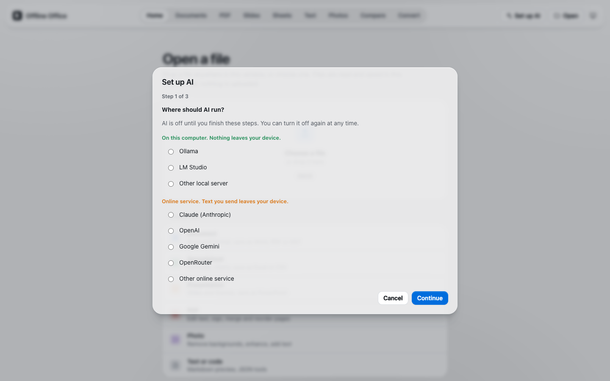
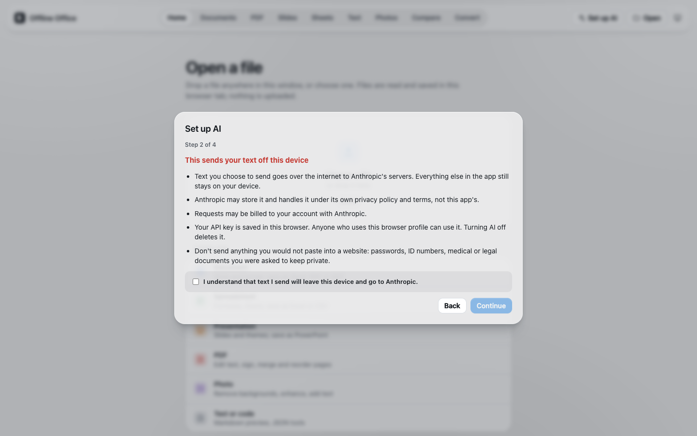
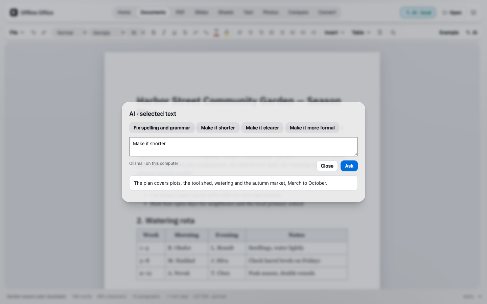

# Offline Office AI

This is [Offline Office](https://github.com/sh1lll/offline-office) with an optional AI assistant
added. If you want the version that never touches the network, use that one. This one is the same
app, plus a way to hook up a model you choose: one running on your own computer (Ollama, LM Studio)
or an online service (Claude, OpenAI, Gemini, OpenRouter or any compatible gateway).

AI is off until you set it up, and the setup makes you read and tick a warning before any online
service can be used. I kept it out of the main build on purpose. It adds code and network access
the main app doesn't need, and an "offline" app that quietly talks to an AI company would be lying.



## How the AI works

- **Off by default.** No AI buttons show anywhere until you finish "Set up AI" in the header.
- **Local first.** Ollama and LM Studio run the model on your own machine, so text you send stays
  on your device.
- **Online needs a tick.** Pick Claude, OpenAI, Gemini, OpenRouter or another online service and
  you get a plain list of what that means: your text goes to that company's servers, they handle
  it under their own policy, it may cost money, and your API key is saved in this browser. The
  Continue button stays locked until you tick "I understand".
- **It tests before it turns on.** The last step sends one short test message so you know it works
  before anything real is sent.
- **It asks before each online request.** You see how many characters are going and to which
  address, and you can cancel. You can turn the question off until you close the tab.
- **One click off.** The AI button in the header shows whether it's local or online. "Turn AI off"
  deletes the saved key.



What it can do right now:

- **Documents:** rewrite the selected text (fix spelling, shorten, make clearer or more formal),
  or summarize the document, suggest a title and list action items.
- **Text:** edit or explain a selection or the whole file.
- **Sheets:** describe what you want and get a formula in the formula bar.
- **PDF:** ask questions about the PDF; answers name the pages they came from.



**Local model setup.** Local servers only answer pages they trust. For Ollama, start it with
`OLLAMA_ORIGINS="*" ollama serve`. For LM Studio, open the Developer tab and turn on "Enable CORS".

## Everything else

The rest of this page is the same as Offline Office.


Simple file jobs should have a simple tool. Fixing a PDF, turning a Word file into a PDF or cropping
a photo shouldn't mean downloading an app, going online, or making an account. And most of the
free tools online work by sending your file to someone else's server, which is a bad deal when the
file is something private, like a contract or an ID.

Offline Office is one HTML file that opens, edits and converts the common file types on your own
device. Nothing gets uploaded and you never make an account. Every library and font ships
inside the app, so it keeps working with Wi-Fi off.

It's a quick editor and converter. It won't replace Microsoft Office or LibreOffice, and some
things are approximate, so read [What is approximate](#what-is-approximate) before you rely on it.

## What it looks like

**Documents.** Write and format, then save as Word, PDF or ODT.


**PDF.** Edit text, sign, highlight, fill forms, merge and reorder pages.


**Slides.** Build a deck and save it as PowerPoint or PDF.


**Sheets.** Formulas, formatting and charts, saved as Excel or CSV.


**Photos.** Remove backgrounds, enhance, crop and add text.


**Text.** Markdown with a live preview, plus JSON and code files.


**Compare.** See every word added, removed or moved between two versions of a file.


**Convert.** Drop in any mix of files and pick a format. Each row shows the route it will take.


It has a dark mode, and it works on a phone.


<p>
  
  &nbsp;
  
</p>

## How one HTML file does all this

Most people think of an HTML file as one piece of a website. It can also be a whole program. A
browser can read your files, draw on a canvas, run compiled code and save files back to your disk,
all without the internet. Offline Office puts every piece it needs into the page itself: the PDF
engine, the Word, Excel and PowerPoint readers and writers, the photo tools, the fonts and the text
recognition. The browser unpacks them when the page opens, so the same file works from your
desktop or a USB stick.

## Get it

- **One file:** download `offline-office-ai.html` from the [Releases](../../releases) page and open
  it in any recent browser. It's about 10 MB.
- **Hosted:** serve this folder with any static file server, or turn on GitHub Pages for the
  repository root. There's no build step for that.

```sh
python3 -m http.server 8000
# open http://localhost:8000
```

To build the single file yourself, run `node build.mjs`. It writes `dist/offline-office.html`, with
every library, font and decoder inside it, stored compressed. It also writes `dist/artifact.html`,
the same page without the document shell, for the claude.ai artifact viewer.

Libraries and fonts live in `vendor/`. To upgrade one, change its URL and hash in `vendor.mjs`,
delete the old file and run `node vendor.mjs`. It checks each library against its pinned SHA-384
hash and stops on a mismatch.

## What it does

| Editor | Opens | Saves |
|---|---|---|
| Documents | DOCX, DOC, ODT, RTF, EPUB, HTML, Markdown, TXT | DOCX, PDF, ODT, RTF, HTML, Markdown, TXT |
| PDF | PDF, plus images to merge | PDF, single pages, pages as PNG |
| Slides | PPTX, PPT, ODP | PPTX, PDF, PNG |
| Sheets | XLSX, XLS, XLSB, ODS, CSV, TSV, Numbers | XLSX, XLS, ODS, CSV, HTML |
| Text | TXT, Markdown, JSON, CSV and about 70 code formats | the same file |
| Photos | JPG, PNG, HEIC, TIFF, WebP, AVIF, GIF, BMP, SVG | PNG, JPG, WebP |
| Compare | Any two of DOCX, DOC, ODT, RTF, EPUB, PDF, HTML, Markdown, TXT | Redline report (HTML, or Word/PDF via Documents) |
| Convert | Any file, any mix, zips unpacked | Any of: PDF, searchable PDF, DOCX, ODT, RTF, EPUB, HTML, Markdown, TXT, JSON, XLSX, XLS, ODS, CSV, TSV, PPTX, PNG, JPG, WebP, GIF, BMP, TIFF, ICO, SVG |

**Convert goes from any format to any format.** When there's no direct way, it chains steps
(a spreadsheet to GIF goes XLSX → HTML → PDF → GIF; a photo to Excel goes PNG → text by OCR → TSV →
XLSX), and each row shows the route before you start. Files the app can't read come through as
text, or as a hex dump if they're binary, so even those convert. Odd pairs give odd but valid
files: a slide deck as JSON is its text, a spreadsheet as a PowerPoint is pictures of its pages.

**Text recognition (OCR)** reads scanned PDFs and photos of text: *Recognize text* in the PDF
editor makes a scan searchable and copyable, *Copy text from image* in Photos sends the text to the
Text editor, and Compare and Convert use it on their own when a PDF has no text. English is built
in. It uses Tesseract and loads only the first time you use it (about 3.5 MB).

**Your files** (on the home screen) keeps the things you reuse, in this browser:
- fonts (.ttf, .otf, .woff, .woff2): in every font menu, and embedded in PDFs you save;
- images (logos, signatures, stamps): offered first whenever you insert or open a picture;
- templates (any document, sheet, deck, PDF or text file): listed on the home screen, and opening
  one gives a copy, so the template stays as it was;
- OCR languages (.traineddata files from
  [tessdata_fast](https://github.com/tesseract-ocr/tessdata_fast)).

Apple Pages, Keynote and Numbers files open their embedded preview (a PDF or image), not the
editable document.

## What is approximate

- **PDF "Edit text" covers the original instead of removing it.** The old text stays in the
  file underneath your new text, and anyone can copy it out. White-out works the same way.
  Neither hides sensitive information.
- **New PDF text uses the 14 standard PDF fonts, or Noto Sans** for Latin, Greek and Cyrillic
  characters outside them. Other scripts (Chinese, Japanese, Arabic, Hindi, emoji) are saved
  as "?", and the app tells you which characters were replaced.
- **PDFs from Documents and Text use the standard PDF fonts.** Text is real, searchable text laid
  out exactly where the editor shows it, but drawn in Times, Helvetica or Courier (or Noto Sans),
  stretched slightly to match the screen font's spacing. Checkboxes in Markdown task lists print as
  plain bullets. Slide PDFs are images of the slides.
- **Background removal is color-based, not AI.** It flood-fills from the edges of the photo,
  so it works on plain or studio backgrounds and struggles with busy scenes.
- **Old .doc and .ppt files import text only.** Paragraphs, lists and tables come through;
  fonts, images and layout do not.
- **Office files are converted, not edited natively.** Complex Word layouts, tracked changes,
  comments, slide animations, SmartArt, charts and macros are simplified or dropped.
- **Compare works on text, not layout.** It shows words added, removed and moved, but not
  formatting-only changes (a word turning bold) or changes in images. Scanned PDFs are read
  with OCR, so expect some recognition mistakes to show up as changes.
- **Upscaling is Lanczos resampling with sharpening**, not AI super-resolution.
- **OCR uses the compact English model.** Clean scans and screenshots read well; photos at an
  angle, handwriting and small or faint print come out with mistakes. Turning a page after
  recognizing it removes its recognized text; run Recognize text again.
- **Convert goes through the editors**, so it replaces what is open in them (it asks first if
  something is unsaved). Long chains lose what each step cannot carry: CSV, TSV and JSON hold only
  the first sheet, images and PowerPoint from documents are pictures of pages, GIF uses a fixed
  252-color palette, and text from slides or images comes from OCR.
- **Added fonts** are named after their file (Inter-Bold.ttf becomes "Inter Bold"). TTF and OTF
  are tested in PDFs; if a font cannot be embedded, the PDF uses a standard font for that text.
- **Formulas** cover 76 common functions (SUM, IF, VLOOKUP, XLOOKUP, SUMIF, ROUND and
  more). Unknown functions show `#NAME?`.

## Privacy and security

- Files never leave the tab unless you send text to an AI service you set up. The Content Security
  Policy lets the page load only its own files, and allows network requests only to a model server
  on this computer or to HTTPS addresses, which the opt-in AI needs. Opened documents are
  sanitized and never run scripts, so they can't use that access. If you want no network access at
  all, use [Offline Office](https://github.com/sh1lll/offline-office).
- Your API key is stored in this browser's local storage and sent only to the service you chose.
  Claude requests go through the official Anthropic SDK (`vendor/anthropic-sdk.min.js`).
- Libraries are copied into `vendor/` from pinned versions and checked against SHA-384 hashes
  by `vendor.mjs`. Fonts are copied from Google Fonts the same way, Latin and Latin Extended only
  (other scripts use the system font).
- Imported HTML is sanitized with DOMPurify; the HTML preview runs in a sandboxed frame.
- Spreadsheet formulas are compiled to JavaScript. `compile()` in `src/formula.js` only lets
  cell references, numbers, strings, operators and known functions through, and
  `test/formula.test.js` checks that injection attempts are rejected. This is why the CSP
  allows `'unsafe-eval'`.
- pdf.js runs with `isEvalSupported: false` (CVE-2024-4367).

## Code layout

```
index.html          page shell, CSP, library tags
src/styles.css      all styles
src/core.js         helpers, dialogs, saving, routing, home screen
src/formats.js      importers and exporters (DOC, PPT, ODT, ODP, RTF, EPUB, HEIC, TIFF…)
src/formula.js      spreadsheet formula engine
src/diff.js         comparison engine (paragraphs, then words)
src/documents.js    Documents editor
src/pdf.js          PDF editor
src/slides.js       Slides editor
src/sheets.js       Sheets editor
src/text.js         Text editor
src/photos.js       Photo editor
src/compare.js      Compare screen
src/convert.js      batch converter
src/addons.js       your files: fonts, images, templates, OCR languages (IndexedDB)
src/ai.js           opt-in AI: setup steps, providers, the AI panel in each editor
src/boot.js         start-up checks
vendor/             libraries and interface fonts (committed, from vendor.mjs)
assets/             Noto Sans fonts for PDF text
test/               node --test (formula, diff, and converter tests in headless Chrome)
docs/screenshots/   images for this README
PRODUCT.md          who it is for and the design principles
RELEASING.md        steps for posting a release
vendor.mjs          downloads and checks vendor/
build.mjs           single-file build
```

Each script is a plain browser script; they share globals and load in the order above.

Run the tests with `node --test` (Node 22 or newer). Besides the formula and diff tests, it opens
the app in headless Chrome (found automatically, or set `CHROME=/path/to/chrome`) and converts ten
sample files to all 24 formats in both index.html and the single-file build, checks that every result
opens, and fails if any request leaves the machine. Set `SPEED=1` to print the slowest conversions.
Without Chrome those tests are skipped.

## Credits

| Library | Used for | License |
|---|---|---|
| [pdf.js](https://github.com/mozilla/pdf.js) | Showing PDFs | Apache-2.0 |
| [pdf-lib](https://github.com/Hopding/pdf-lib) and [@pdf-lib/fontkit](https://github.com/Hopding/fontkit) | Writing PDFs | MIT |
| [SheetJS Community Edition](https://sheetjs.com) | Spreadsheet files | Apache-2.0 |
| [mammoth](https://github.com/mwilliamson/mammoth.js) | Reading DOCX | BSD-2-Clause |
| [docx](https://github.com/dolanmiu/docx) | Writing DOCX | MIT |
| [PptxGenJS](https://github.com/gitbrent/PptxGenJS) | Writing PPTX | MIT |
| [JSZip](https://github.com/Stuk/jszip) | ZIP-based formats | MIT (dual MIT/GPL-3.0) |
| [marked](https://github.com/markedjs/marked) | Markdown | MIT |
| [DOMPurify](https://github.com/cure53/DOMPurify) | Sanitizing HTML | Apache-2.0 (dual Apache-2.0/MPL-2.0) |
| [html2canvas](https://github.com/niklasvh/html2canvas) | Slide images | MIT |
| [tesseract.js](https://github.com/naptha/tesseract.js) and [Tesseract](https://github.com/tesseract-ocr/tesseract) | Text recognition | Apache-2.0 |
| [tessdata_fast](https://github.com/tesseract-ocr/tessdata_fast) English model | Text recognition | Apache-2.0 |
| [Anthropic SDK](https://github.com/anthropics/anthropic-sdk-typescript) | Talking to Claude (AI edition only) | MIT |
| [heic2any](https://github.com/alexcorvi/heic2any) | HEIC photos (bundles libheif, LGPL-3.0) | MIT |
| [UTIF.js](https://github.com/photopea/UTIF.js) | TIFF photos | MIT |
| [pako](https://github.com/nodeca/pako) | TIFF decompression | MIT and Zlib |
| [Noto Sans](https://github.com/notofonts/latin-greek-cyrillic) | PDF text (in `assets/`) | SIL OFL 1.1, see `assets/OFL.txt` |
| IBM Plex Sans and Mono, Bricolage Grotesque, Caveat, Dancing Script, Anton, Bebas Neue, Pacifico, Playfair Display | Interface and photo text (in `vendor/fonts/`) | SIL OFL 1.1 |
| Permanent Marker | Photo text (in `vendor/fonts/`) | Apache-2.0 |

Font licenses are in `vendor/fonts/licenses/`. Everything is bundled; nothing loads from a CDN.

## Contributors

- [sh1ll](https://github.com/sh1lll): creator

Want to help? Open an issue first for anything bigger than a small fix, and run `node --test`
before you send a pull request.

## License

MIT, see [LICENSE](LICENSE). This covers the code in this repository, not the libraries above.
